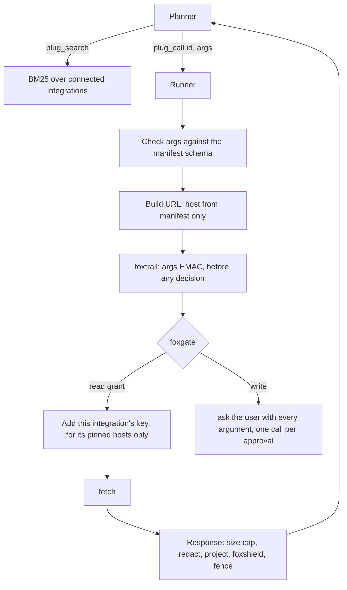
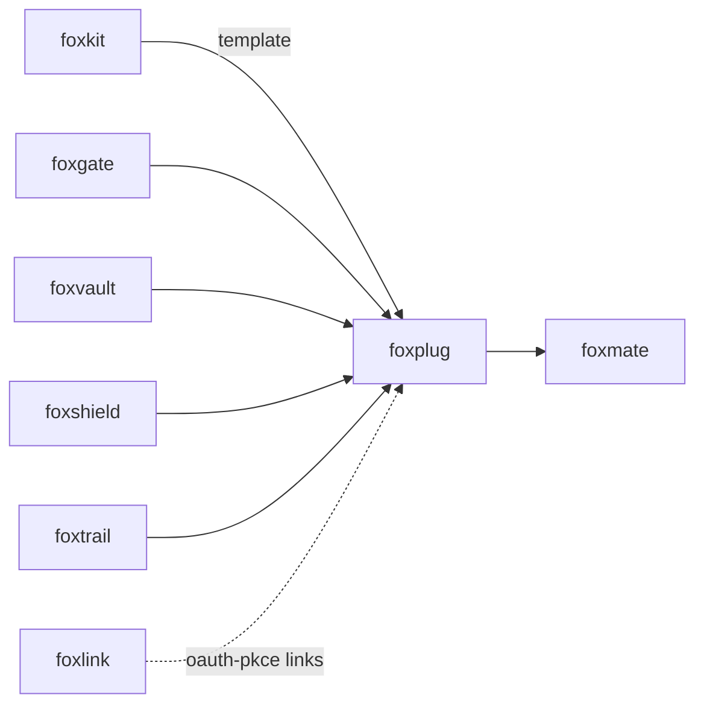

# foxplug

<p align="center">Private integrations for local-model browser agents.</p>

<p align="center">
  <a href="https://github.com/pooriaarab/foxplug/actions"></a>
  <a href="LICENSE"></a>
</p>

foxplug lets an AI agent use web APIs such as GitHub, Notion, and Slack with
the user's own keys, and with no server in between. An integration is a JSON
manifest, not code. One fixed runner reads the manifest and sends the request.
The planner sees three tools: `plug_search`, `plug_describe`, and `plug_call`.

Your keys stay on the device in [foxvault](https://github.com/pooriaarab/foxvault),
pinned to the hosts in the manifest. [foxgate](https://github.com/pooriaarab/foxgate)
asks the user before each write. [foxshield](https://github.com/pooriaarab/foxshield)
cleans each response, and [foxtrail](https://github.com/pooriaarab/foxtrail) logs
each call. The npm package is `foxplug-agent`, because another project uses the
name `foxplug`.

## Install

```bash
npm i foxplug-agent foxgate foxvault
```

You need Node 24 or later, or a Firefox extension.

## Example

This runs as written. With no token it stops at the approval step, so it sends
nothing to GitHub.

```js
import { createFoxgate } from "foxgate";
import { createVault } from "foxvault";
import { connectKey, createPlanner, createRunner, gateTools, GOLD } from "foxplug-agent";

const github = GOLD.find((m) => m.id === "github");
const vault = createVault();
await vault.initialize();
await connectKey(vault, github, process.env.GITHUB_TOKEN ?? "paste-your-token-here");

const { gate, host } = createFoxgate({ tools: gateTools([github]) });
await host.addGrant({ scope: "read", domains: ["api.github.com"] });
await host.addGrant({ scope: "submit", domains: ["api.github.com"] });

const runner = createRunner({ manifests: [github], vault, gate });
const planner = createPlanner({ runner, manifests: [github], connected: () => ["github"] });

console.log(planner.prompt());
const found = await planner.run("plug_search", { query: "open an issue", limit: 2 });
console.log(found.results.map((r) => r.signature));

const args = { owner: "me", repo: "notes", title: "Try foxplug" };
const asked = await planner.run("plug_call", { id: "github.issue_create", args });
console.log(asked.status, asked.render);
// Show asked.render to the user. When they approve:
// const token = await host.approve(asked.requestId);
// await planner.run("plug_call", { id: "github.issue_create", args, approval: token });
```

Output:

```text
Connected integrations: GitHub (issues, pull requests and repositories).
[
  'github.issue_create(owner: string, repo: string, title: string, body?: string) [submit: asks the user]',
  'github.issue_list(owner: string, repo: string, state?: string, per_page?: integer) [read]'
]
ask Open the issue "Try foxplug" in me/notes
```

## Use cases

| Who | What they build | How foxplug helps |
|---|---|---|
| A browser agent author (for example foxmate) | An agent on a small local model that can file issues and add tasks | The model sees 3 tools, not 25 action schemas. Writes wait for the user. |
| A privacy-minded user | A personal assistant that reads their Linear and Todoist | Keys and data go only from the browser to the vendor. No relay sees them. |
| An MCP server or tool-loop author | A tool layer for any agent framework | `plug_describe` returns a closed JSON Schema, ready for a grammar such as the llama-server `json_schema` option. |
| A team with an internal API | A custom integration for their own service | Write one JSON manifest. The runner, the approvals, and the logging come with it. |
| A security reviewer | A review of what an agent can reach | Each manifest lists its hosts and the scope of each action. Data cannot add code. |

## How it works



1. `parseManifest` refuses a manifest that could choose its host from data.
   Hosts are literal hostnames. A `{arg}` fills a whole path segment, a query
   value, or a body value, and nothing else. A `read` action runs with no
   approval, so it must be a `GET`, and a manifest cannot use the `fill` scope.
   Only the gold catalog has a short, hand-checked list of POST reads.
2. `buildRequest` checks the planner's arguments against the action schema.
   It refuses extra arguments, and path values such as `..` or `a/b`.
3. foxplug writes the foxtrail entry first, so a failed write stops the call
   before it can use up an approval. Then foxgate decides. A read with a grant
   runs. A write returns `ask` with text that shows every argument, and the
   approval token works for that exact call, one time.
4. foxplug adds only the key of the called integration, from its own foxvault
   secret and header rule, and only when the URL host is one that the key was
   saved for. Another integration on the same host never lends its key.
5. In Node, foxplug follows a redirect on the same host and protocol for `GET`,
   at most 3 times, and decides the key again on each hop. It refuses a
   redirect to another host or protocol. In a browser, `fetch` hides where a
   redirect goes (an `opaqueredirect` response with status 0), so foxplug
   refuses every redirect there.
6. The response is cut at 256 KiB. foxvault replaces any echoed key with its
   handle. Only the manifest's `project` fields stay. foxshield strips hidden
   characters and marks instruction text. The result is cut at 8,000
   characters and wrapped in `<untrusted source="foxplug:…">`.

Every failure mode has a test against a local HTTP server: see
[docs/failure-modes.md](docs/failure-modes.md).

## Gold catalog

| Integration | Auth | Actions |
|---|---|---|
| GitHub | Personal access token | search issues, list issues, open an issue, comment |
| Linear | Personal API key | my open issues, teams, create an issue |
| Notion | Internal integration token | search, read page text, create a page |
| Todoist | API token | filter tasks, add a task, close a task |
| Airtable | Personal access token | bases, list records, add a record |
| Slack | Your own app's bot token | channels, read messages, post a message |
| Stripe | Restricted key | balance, charges, find customers (read only) |
| Asana | Personal access token | workspaces, my tasks, create a task |

None of them needs a shared OAuth client ID. The user makes the key in the
vendor's settings and pastes it into your UI, never into the chat.

## API

foxplug is a library only. It has no CLI and no MCP server.

| Export | What it does |
|---|---|
| `parseManifest(json, { loopback? })` | Checks a manifest and returns a frozen copy. Throws `PlugError`. `loopback` allows `127.0.0.1:<port>` hosts, for tests only. |
| `connectKey(vault, manifest, key)` | Saves a pasted key in foxvault as `vault:plug-<id>`, pinned to the manifest hosts, with a header rule from `auth.format`. |
| `gateTools(manifests)` | The foxgate tool registry: `<id>.<action>` with its scope. Pass it to `createFoxgate({ tools })`. |
| `createRunner(options)` | Returns `{ call(tool, args, { token? }) }`. Options: `manifests`, `vault`, `gate`, `trail`, `links` (foxlink links for `oauth-pkce`), `argsKey` (the HMAC key for the args hash; keep one per install), `fetch`, `now`, `maxResponseBytes`, `maxResultChars`. |
| `createPlanner(options)` | Returns `tools`, `prompt()`, `search`, `describe`, `call`, `run(name, input)`, and `newTurn()`. Options: `runner`, `manifests`, `connected`, `maxCallsPerTurn` (default 8). |
| `GOLD` | The 8 gold manifests. |
| `PLANNER_TOOLS` | The 3 tool definitions as JSON Schema. |
| `buildRequest`, `checkArgs`, `project`, `createIndex` | The parts the runner and planner use. |

`call` returns `ok` or `error` with `httpStatus`, `text`, and `truncated`;
`ask` with `requestId` and `render`; or `refused` with a `reason`. Reasons
include `not-connected`, `locked`, `rate-limited` (with `retryAfterMs`),
`redirect`, `redirect-host`, `redirect-protocol`, `too-large`, `log-failed`,
`turn-limit`, `bad-args`, and every foxgate deny reason.

## Firefox APIs used

| API | MDN | Why |
|---|---|---|
| `fetch` with `redirect: "manual"` | [fetch()](https://developer.mozilla.org/en-US/docs/Web/API/Window/fetch) | Sends the request and does not follow redirects. In Firefox a redirect comes back as an [opaqueredirect](https://developer.mozilla.org/en-US/docs/Web/API/Response/type) response with status 0, so foxplug refuses it. |
| `ReadableStream` reader | [ReadableStream](https://developer.mozilla.org/en-US/docs/Web/API/ReadableStream) | Stops reading at the size cap. |
| `crypto.subtle.sign` with HMAC | [SubtleCrypto.sign()](https://developer.mozilla.org/en-US/docs/Web/API/SubtleCrypto/sign) | The HMAC SHA-256 args hash for foxtrail. |

The runner uses no Node-only global such as `Buffer`. A test runs it with
`Buffer` removed.

In an extension, ask for host permissions per integration at connect time,
for example `https://api.github.com/*`. Do not ask for `<all_urls>`.

## Limits

Some services cannot work privately without a server:

- **Webhooks and inbound events.** A device has no public URL, so foxplug
  only polls, and only while the browser runs. A user can run their own relay.
- **Providers that need an approved app with a secret**, such as Meta (Facebook
  and Instagram), LinkedIn member APIs, and TikTok. Use the user's own app if
  the provider allows one, or leave the service out.
- **Providers with a web-only redirect rule** that refuses the Firefox loopback
  redirect.
- **Google restricted scopes** (full Gmail, Drive). Use foxlink with the user's
  own client ID.
- **Long background work.** Firefox unloads event pages.

This first version also has these limits:

- The gold manifests pass tests against a local server. They have not yet run
  against the live APIs. Check each one with a real key before you rely on it.
- Keys go in a header only. An API that wants its key in the query string,
  such as OpenWeather, does not work.
- There is no signed catalog, no remote MCP client, and no device flow yet.
- foxplug has no score yet on the foxmate benchmark for integration tasks.
- `oauth-pkce` needs a link from foxlink that your code makes.
- In a string that foxshield marks, line breaks become spaces.
- In a browser, foxplug follows no redirect. An API that answers with a
  redirect gets the reason `redirect`.
- With no `argsKey`, each runner makes a new HMAC key, so the same args give
  another hash after a restart.

## Part of the fox primitives



foxplug depends on foxgate, foxvault, foxshield, and foxtrail from npm. It
takes foxlink links through an option, so it does not depend on foxlink.

## License

[MIT](LICENSE)
